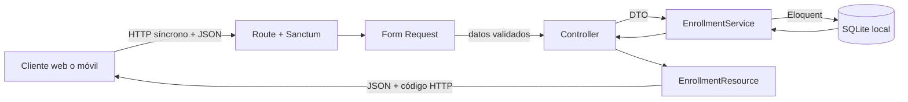
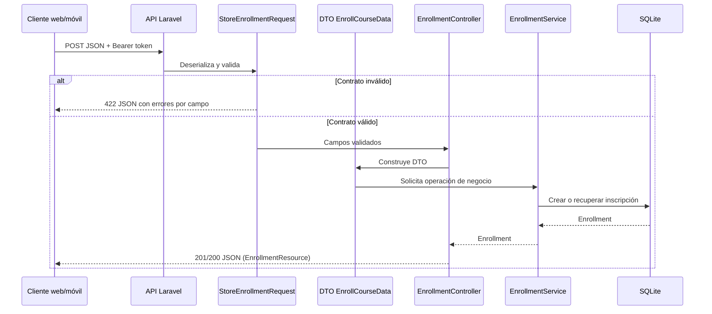

# Contrato JSON — Inscripción a un curso de ILIA

## Datos de entrega

- **Estudiante:** Carlos Chile
- **Curso / paralelo:** 8.º nivel / A
- **Fecha:** 15 de noviembre de 2026

## Proceso y participantes

- **Proceso:** consultar y administrar las inscripciones del docente autenticado en el catálogo.
- **Cliente:** aplicación web o móvil de ILIA.
- **Backend:** API Laravel de esta práctica.
- **Identidad:** se obtiene del token Bearer. El cliente no envía `user_id` en el cuerpo; así se conserva la decisión del backend de ILIA.
- **Transporte:** HTTP síncrono con JSON (`Content-Type: application/json`, `Accept: application/json`).
- **Persistencia:** una inscripción válida se guarda en SQLite. La pareja docente/curso es única; repetir el mismo POST devuelve el recurso existente con HTTP 200.

## Solicitud

```json
{
  "course_slug": "prompting-para-docentes",
  "cohort_code": "ILIA-DEMO"
}
```

| Campo | Tipo JSON | Obligatorio | Significado y validación |
|---|---|---:|---|
| `course_slug` | string | Sí | Slug del curso publicado/sembrado; debe existir en `courses`, máximo 160 caracteres. |
| `cohort_code` | string o null | No | Código corto de cohorte de la charla; si se envía como texto debe existir en `cohorts`, máximo 32 caracteres. Si se omite o vale `null`, la inscripción queda sin cohorte. |

## Respuesta de éxito — HTTP 201

```json
{
  "data": {
    "id": "8f3d3dc9-4b1c-45b8-a062-535dd098f1c9",
    "course_id": "ab14637e-bef7-4d4d-bc8c-e98036775e07",
    "enrolled_at": "2026-11-15T12:00:00.000000Z",
    "cohort_id": "fba2227c-10b3-41ed-8f7f-9aa12c219ec9"
  }
}
```

| Campo | Tipo JSON | Obligatorio | Significado |
|---|---|---:|---|
| `data` | object | Sí | Contenedor estable del recurso devuelto. |
| `data.id` | string (UUID) | Sí | Identificador único de la inscripción. |
| `data.course_id` | string (UUID) | Sí | Identificador del curso inscrito. |
| `data.enrolled_at` | string (fecha/hora ISO 8601) | Sí | Instante UTC en que se creó la inscripción. |
| `data.cohort_id` | string (UUID) o null | Sí | Cohorte asociada; `null` cuando no se indicó una. |

Los UUID y la fecha del ejemplo son ilustrativos: las respuestas reales contienen los valores generados por la base local.

En conjunto, los dos contratos describen seis campos de negocio: dos en la solicitud y cuatro en `data` en la respuesta.

## Recursos REST de inscripciones

Cada ruta requiere autenticación Bearer de Sanctum. El usuario se obtiene del token; cualquier inscripción ajena responde `404`, igual que un identificador inexistente, para no revelar recursos de otras cuentas.

| Método | Endpoint | Solicitud | Respuesta |
|---|---|---|---|
| `GET` | `/api/enrollments` | Sin cuerpo. | `200`, lista paginada bajo `data`, con `links` y `meta`. Solo incluye inscripciones propias. |
| `POST` | `/api/enrollments` | Contrato de inscripción descrito arriba. | `201` al crear, `200` cuando ya existía. |
| `GET` | `/api/enrollments/{id}` | Sin cuerpo. | `200` y un objeto `data` con los cuatro campos de respuesta. |
| `PATCH` | `/api/enrollments/{id}` | Al menos uno: `course_slug` string existente, `cohort_code` string existente o `null`. | `200` y el recurso actualizado. Enviar `cohort_code: null` quita la cohorte. |
| `DELETE` | `/api/enrollments/{id}` | Sin cuerpo. | `204` sin cuerpo cuando elimina el recurso propio. |

Un `PATCH` vacío, con tipos incorrectos, con una referencia inexistente o que duplique la pareja docente/curso devuelve `422` con `errors` por campo. Una operación sobre una inscripción no propia devuelve `404` y deja la base sin cambios.

## Errores y códigos HTTP

| Código | Situación | Forma de respuesta |
|---:|---|---|
| 201 | Inscripción nueva creada. | `{"data": { ... }}` |
| 200 | El docente ya estaba inscrito al mismo curso; se devuelve el recurso existente. | `{"data": { ... }}` |
| 401 | Falta un token Bearer válido. | JSON de error de autenticación. |
| 422 | Falta un campo, hay un tipo incorrecto o un slug/código no existe. | `message` y objeto `errors` con el campo inválido. |
| 404 | El recurso no existe o pertenece a otra cuenta. | JSON de error, sin información del propietario. |
| 204 | La inscripción fue eliminada correctamente. | Sin cuerpo. |

## Serialización y deserialización

Laravel interpreta el cuerpo `application/json` como datos de la petición. `StoreEnrollmentRequest` y `UpdateEnrollmentRequest` validan presencia, tipo, longitud y existencia de cada valor. Solo los valores validados pasan a DTO inmutables. El controlador coordina la petición HTTP y `EnrollmentService` aplica las reglas del proceso y persiste con Eloquent. `EnrollmentResource` define explícitamente los nombres y valores de salida, que Laravel serializa a JSON. Ante validación fallida, Laravel responde 422 antes de ejecutar la escritura, por lo que no queda ninguna inscripción inválida.

## Arquitectura de integración aplicada



- **Heterogeneidad e interoperabilidad:** clientes web o móviles pueden estar escritos con otras tecnologías; JSON sobre HTTP define el formato y protocolo compartidos.
- **Acoplamiento y cohesión:** cada clase tiene una responsabilidad concreta. Los clientes dependen del contrato estable, no de los modelos Eloquent ni del esquema de almacenamiento.
- **Arquitectura distribuida:** el cliente y la API se comunican mediante solicitud y respuesta de red; esta versión usa un solo backend central y una base local SQLite.
- **Integración en la capa de datos:** el backend Laravel media todo acceso a persistencia. Ningún cliente accede directamente a la base de datos. Las claves foráneas y la restricción única protegen las relaciones y evitan inscripciones duplicadas.
- **Fase siguiente:** reemplazar SQLite por PostgreSQL en una VM Ubuntu, configurar acceso de red y probar migraciones y CRUD desde otro equipo. Esta conexión no forma parte de la versión actual.

## Flujo



## Pruebas mínimas de la guía

La automatización PHPUnit reproduce estos casos con una base SQLite en memoria. Las respuestas observadas se guardan en [`../evidencias/README.md`](../evidencias/README.md).

| Caso | Entrada | Resultado esperado | Resultado verificado |
|---|---|---|---|
| P1 | `course_slug` existente y `cohort_code` válido opcional | HTTP 201, JSON con `data`, inscripción persistida. | PHPUnit: aprobado. |
| P2 | Se omite `course_slug`. | HTTP 422, error asociado a `course_slug`, sin escritura. | PHPUnit: aprobado. |
| P3 | `course_slug` es número (`42`) en vez de string. | HTTP 422, error asociado a `course_slug`, sin escritura. | PHPUnit: aprobado. |

También se verifica autenticación, cohorte omitida/null, cohorte inexistente e idempotencia de la inscripción.

## Reflexión individual (borrador para revisar)

1. **¿Qué problema de integración resolví?** Definí cómo el cliente web o móvil solicita una inscripción y cómo la API devuelve sus datos, para que ambos lados usen los mismos nombres y tipos. La validación también evita que un slug o un código de cohorte inexistente termine guardado.
2. **¿Qué decisión técnica tomé y por qué?** Separé la validación (`StoreEnrollmentRequest`), los datos validados (`EnrollCourseData`) y la respuesta (`EnrollmentResource`). Además, la identidad del docente se toma del token de Sanctum y no de un campo del JSON, siguiendo el flujo de ILIA.
3. **¿Cómo verifiqué que funciona?** Ejecuté las pruebas automatizadas y envié solicitudes HTTP al servidor Laravel local. La solicitud válida recibió 201; al omitir `course_slug` o enviarlo como número, el servidor devolvió 422 y no guardó una inscripción inválida.

Este texto está preparado con los resultados comprobables de la implementación. Revísalo y ajústalo con tus propias palabras antes de entregar la actividad individual.

## Implementación de referencia

El contrato se materializa en el proyecto Laravel de la raíz:

- DTO de entrada: [`EnrollCourseData`](../../app/Data/Enrollment/EnrollCourseData.php).
- Validación: [`StoreEnrollmentRequest`](../../app/Http/Requests/StoreEnrollmentRequest.php) y [`UpdateEnrollmentRequest`](../../app/Http/Requests/UpdateEnrollmentRequest.php).
- Flujo HTTP: [`EnrollmentController`](../../app/Http/Controllers/Api/EnrollmentController.php) y [`routes/api.php`](../../routes/api.php).
- Reglas y persistencia: [`EnrollmentService`](../../app/Services/EnrollmentService.php).
- JSON de salida: [`EnrollmentResource`](../../app/Http/Resources/EnrollmentResource.php).
- Verificación automatizada: [`EnrollmentContractTest`](../../tests/Feature/EnrollmentContractTest.php).
