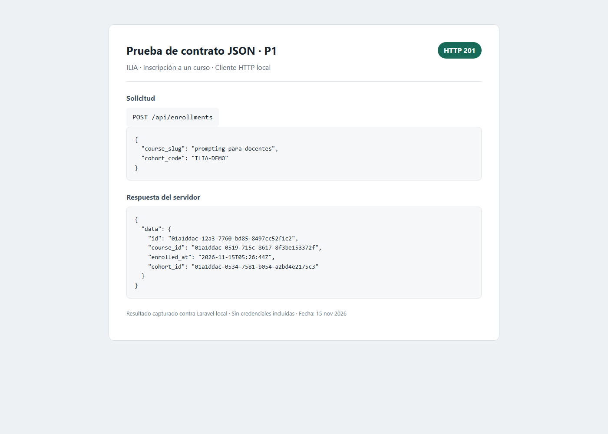
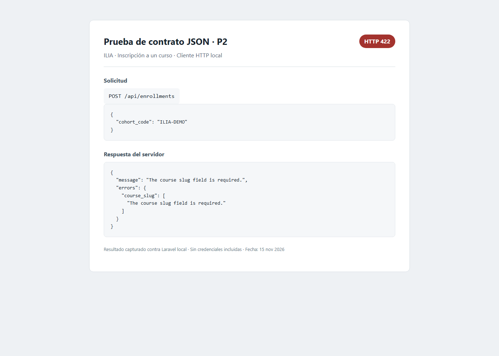
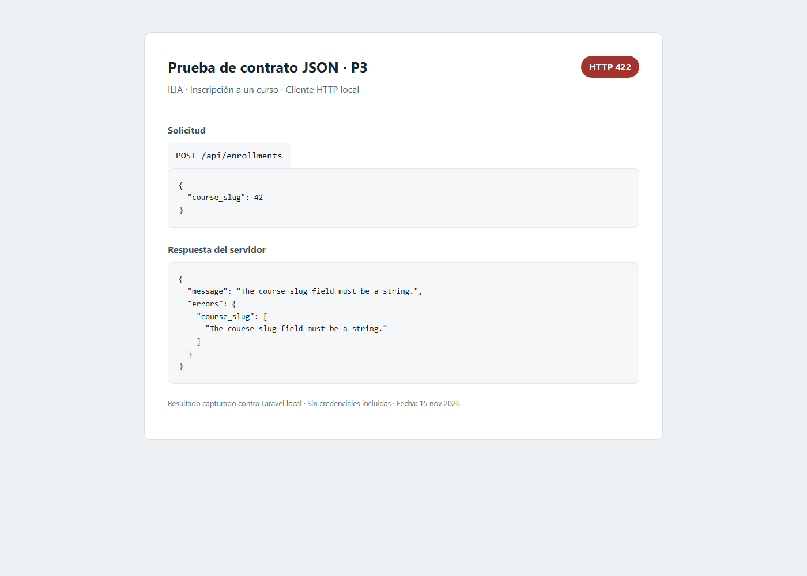

# Evidencias de pruebas

Ejecuta `php artisan test` desde la raíz del proyecto. PHPUnit usa SQLite en memoria, así que cada caso empieza sin inscripciones y los datos de prueba no alteran la base local. La instancia desplegada en Ubuntu usa PostgreSQL; las credenciales y el token temporal se omiten de las evidencias y del repositorio.

## Resultados automatizados

| Captura/caso | Prueba | Verificación |
|---|---|---|
| P1 — éxito | `test_valid_json_creates_enrollment_and_returns_serialized_resource` | HTTP 201, estructura JSON y una inscripción persistida. |
| P2 — campo obligatorio ausente | `test_missing_course_slug_returns_422_without_persisting` | HTTP 422, detalle en `course_slug`, cero inscripciones. |
| P3 — tipo incorrecto | `test_wrong_course_slug_type_returns_422_without_persisting` | HTTP 422 al enviar `course_slug: 42`, cero inscripciones. |

Los tres casos están implementados como pruebas de integración en `tests/Feature/EnrollmentContractTest.php`. La misma suite cubre CRUD autenticado, aislamiento por usuario, actualización parcial, eliminación e idempotencia. Para repetirlos desde Postman, importa `postman/ILIA-Inscripciones.postman_collection.json`, configura `base_url` y un token ficticio, y ejecuta las solicitudes P1/P2/P3 y los ejemplos CRUD. Para consultar, actualizar o eliminar, configura también `enrollment_id` con un identificador propio devuelto por la API. No se incluye un token en el repositorio.

En la verificación automatizada, `php artisan test` aprobó **16 pruebas y 65 aserciones** con SQLite en memoria. En la VM Ubuntu, Laravel confirmó conexión `pgsql` a PostgreSQL 18.6 y las siete migraciones quedaron aplicadas. Una solicitud autenticada real `POST /api/enrollments` devolvió HTTP 201 con JSON `data`; el `DELETE` devolvió HTTP 204 y la petición sin token devolvió HTTP 401 JSON. El registro de prueba y su token se eliminaron después de la verificación.

## Capturas

**P1 — JSON válido, HTTP 201**

**P2 — falta `course_slug`, HTTP 422**

**P3 — `course_slug` con tipo numérico, HTTP 422**

Los datos fuente de las capturas están en [`http-results.json`](http-results.json); las vistas HTML están disponibles como [`P1.html`](P1.html), [`P2.html`](P2.html) y [`P3.html`](P3.html).
