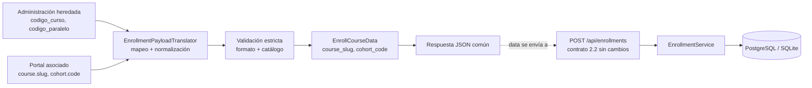

# Mapa de traducción y contrato común

## Componentes y conflicto estructural

Los dos orígenes representan una inscripción del catálogo ILIA:

- **Origen A – administración heredada:** usa nombres en español en un objeto plano. El curso puede llegar con espacios y mayúsculas; el paralelo se maneja como código.
- **Origen B – portal asociado:** agrupa los datos en objetos `course` y `cohort`, con nombres en inglés.
- **Backend común:** el DTO `EnrollCourseData` y el endpoint de 2.2 usan `course_slug` y `cohort_code`.

| Dato | Origen A: administración heredada | Origen B: portal asociado | Contrato común | Transformación |
|---|---|---|---|---|
| Curso | `codigo_curso` (plano, español) | `course.slug` (anidado, inglés) | `course_slug` | Renombrar; quitar espacios externos; convertir a minúsculas; validar formato y existencia en `courses.slug`. |
| Paralelo/cohorte | `codigo_paralelo` (plano, español) | `cohort.code` (anidado, inglés) | `cohort_code` | Renombrar; quitar espacios externos; convertir a mayúsculas; validar formato y existencia en `cohorts.code`. |

Las estructuras difieren en **nombres de campos**, **idioma**, **estructura plana frente a anidada** y **uso de mayúsculas/espacios**. El campo de cohorte es opcional en ambos orígenes; si no llega, el contrato común contiene `cohort_code: null`.

## Entradas de ejemplo

### Origen A – administración heredada

```json
{
  "codigo_curso": " PROMPTING-PARA-DOCENTES ",
  "codigo_paralelo": " ilia-demo "
}
```

### Origen B – portal asociado

```json
{
  "course": {
    "slug": "prompting-para-docentes"
  },
  "cohort": {
    "code": "ILIA-DEMO"
  }
}
```

## Contrato JSON normalizado

La petición del adaptador declara el origen y anexa su payload. El campo `source` solo acepta `legacy` o `portal`:

```json
{
  "source": "legacy",
  "payload": {
    "codigo_curso": " PROMPTING-PARA-DOCENTES ",
    "codigo_paralelo": " ilia-demo "
  }
}
```

Ambos orígenes producen la misma salida:

```json
{
  "data": {
    "course_slug": "prompting-para-docentes",
    "cohort_code": "ILIA-DEMO"
  }
}
```

El objeto `data` es el contrato de entrada del endpoint existente `POST /api/enrollments`. La normalización solo prepara el mensaje: no escribe datos ni asigna la identidad del usuario; el backend sigue obteniendo la identidad desde Sanctum.

## Reglas de validación

1. Cada formato permite solo sus campos definidos. Claves extra o contradictorias generan error bajo `payload`.
2. Los campos de origen deben llegar como texto; números y estructuras mal formadas se rechazan sin coerción.
3. `course_slug` queda en minúsculas y debe cumplir el formato de slug y existir en el catálogo.
4. `cohort_code` queda en mayúsculas, puede ser `null`, y si contiene texto debe cumplir el formato de código y existir en el catálogo.
5. `source` desconocido, campos requeridos ausentes y referencias inexistentes producen HTTP 422 con errores JSON explícitos.
6. El endpoint de normalización requiere autenticación Bearer y devuelve HTTP 200 con el objeto común válido.

## Diagrama del proceso



El servicio mantiene el mapeo en un adaptador de integración dedicado. Así, las diferencias no se dispersan por el controlador ni obligan a modificar los componentes de origen o el contrato común.
