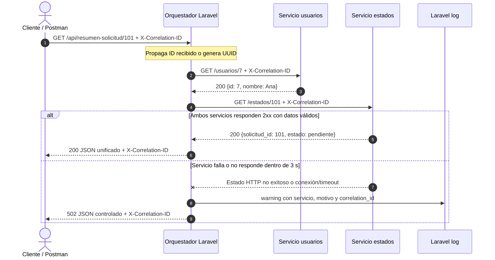

# Práctica 3.3 Orquestación y composición de capacidades

**Estudiante:** Carlos Chile · **Curso:** 8.º nivel / A · **Proyecto:** ILIA

## Objetivo

El endpoint orquestador combina el usuario y el estado de una solicitud desde dos servicios HTTP independientes. El cliente obtiene un único JSON y puede correlacionar la solicitud distribuida usando `X-Correlation-ID`.

## Componentes

- Orquestador Laravel: `GET /api/resumen-solicitud/{solicitudId}`.
- Servicio de usuarios: `GET http://127.0.0.1:8091/usuarios/7` → `{"id":7,"nombre":"Ana"}`.
- Servicio de estados: `GET http://127.0.0.1:8092/estados/101` → `{"solicitud_id":101,"estado":"pendiente"}`.
- Controlador: `app/Http/Controllers/Api/SolicitudSummaryController.php`.

Las URL base se configuran con `PRACTICA33_USERS_URL` y `PRACTICA33_STATES_URL`. Sus valores predeterminados son los puertos locales anteriores. Cada llamada upstream usa `Http::timeout(3)` y propaga el ID de correlación.

## Iniciar el laboratorio

Abre tres terminales PowerShell en la raíz del repositorio. Mantén cada proceso activo mientras haces las peticiones:

**Terminal 1 — servicio de usuarios**

```powershell
php -S 127.0.0.1:8091 3.3/servicios/usuarios/router.php
```

**Terminal 2 — servicio de estados**

```powershell
php -S 127.0.0.1:8092 3.3/servicios/estados/router.php
```

**Terminal 3 — API orquestadora Laravel**

```powershell
php artisan serve --host=127.0.0.1 --port=8000
```

Comprueba directamente los dos servicios en navegador o Postman y luego importa `postman/Practica-3.3-Orquestacion.postman_collection.json`.

## Respuesta normal

Con `X-Correlation-ID: practica33-postman-01`, `GET http://127.0.0.1:8000/api/resumen-solicitud/101` devuelve HTTP 200:

```json
{
  "solicitud_id": 101,
  "usuario": {"id": 7, "nombre": "Ana"},
  "estado": "pendiente",
  "correlation_id": "practica33-postman-01"
}
```

El mismo valor aparece en la cabecera de respuesta `X-Correlation-ID` y se envía a ambos servicios. Si el encabezado no llega o contiene caracteres no permitidos, Laravel genera un UUID. El ID aceptado admite hasta 64 caracteres ASCII entre letras, números y `._:-`.

## Simular que un servicio no responde

1. Envía primero la petición `Flujo normal` de Postman y guarda el ID de correlación que muestra.
2. En la Terminal 2, presiona **Ctrl+C** para detener el servicio de estados.
3. Envía `Fallo servicio de estados`. La conexión a `127.0.0.1:8092` falla y el orquestador responde HTTP 502 con JSON controlado. No incluye excepción ni traza.
4. Abre `storage/logs/laravel.log` y busca el mismo `correlation_id`. El registro identifica `service: estados`, `reason: connection_error` y no guarda trazas.
5. Reinicia el servicio de estados con el comando de la Terminal 2 y repite la petición normal; debe volver a HTTP 200.

Respuesta de fallo:

```json
{
  "mensaje": "No fue posible completar el resumen de la solicitud.",
  "correlation_id": "practica33-postman-fail-01"
}
```

Los fallos de HTTP no exitoso y las respuestas upstream con forma inválida también producen HTTP 502. Si usuarios falla, estados no se consulta. El endpoint del ejercicio no escribe en la base de datos.

## Diagrama de secuencia



## Pruebas automatizadas

```powershell
php artisan test tests/Feature/Practica33/Orchestration/SolicitudSummaryTest.php
php artisan test
```

La suite específica cubre composición y equivalencia de ID en ambas llamadas, generación de ID seguro, respuesta HTTP 502 y log ante un servicio no exitoso, conexión rechazada y datos inválidos.

## Evidencias

Las capturas y los registros de respuesta observados en la ejecución están en `evidencias/`. La colección de Postman incluye pruebas automáticas para éxito y caída del servicio.

## Código y repositorio

- [Controlador orquestador](../app/Http/Controllers/Api/SolicitudSummaryController.php)
- [Colección Postman](postman/Practica-3.3-Orquestacion.postman_collection.json)
- [Carpeta 3.3 en GitHub](https://github.com/CarlosJChileS/Integracion-e-implementacion-de-software/tree/main/3.3)


Las capturas PNG son registros visuales generados a partir de los resultados HTTP reales guardados en `evidencias/respuesta-exito.json` y `evidencias/respuesta-fallo.json`. La colección está lista para reproducir ambos flujos en Postman.
